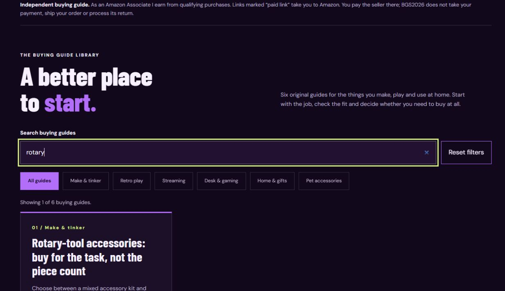

# BGS2026 Finds

The BGS2026 Finds operating guide, first-party website source and Windows local preview program.

**Live website:** [BGS2026 Finds](https://brutal-game-studios-neon.brutalmotorworks.chatgpt.site/finds/)

**Start here:** [Illustrated user guide](docs/USER_GUIDE.md) · [Dependencies and prerequisites](docs/DEPENDENCIES.md) · [Developer and build guide](docs/DEVELOPMENT.md) · [Free promotion plan](docs/FREE_PROMOTION.md)



## Downloads

- [Windows preview EXE](downloads/BGS2026-Finds-Preview.exe) — choose **Download raw file** on GitHub. This is an unsigned local preview viewer, not an installer or an Amazon API client.
- [Checksums](downloads/SHA256SUMS.txt) — compare the downloaded EXE's SHA-256 before running it.
- Source: download the repository ZIP using GitHub's **Code → Download ZIP** menu, or clone the repository. This package is in `bgs2026/`.
- Browser-readable and printable guide: open `docs/USER_GUIDE.html` from a downloaded copy, or use the EXE's **Read user guide** button.

The EXE requires Windows and Microsoft .NET Framework 4.8 or 4.8.1. It embeds the preview pages and guide, listens only on a random loopback port, and opens your default browser. Closing its window stops the preview. A normal web browser is sufficient for the live site. See the [software table](docs/DEPENDENCIES.md).

## What is included

- Six complete buying guides, three original product selections, guide search and categories.
- About, Contact, Privacy and affiliate-disclosure pages.
- HTML, CSS, JavaScript and the original Finds content/rendering/validation source.
- A dependency-free Node.js static build and preview server.
- C# source, resource bundler and PowerShell build script for the Windows EXE.
- Screenshots, operating instructions, promotion drafts, product queue and verification notes.

The portable build is a labeled snapshot. Its canonical links point to the existing live site, and it asks crawlers not to index it. The studio's unrelated apps, commercial checkout, customer database and private hosting configuration are outside this Finds package.

## Quick start

For browsing: open the live site. For the Windows local copy: download and run the EXE, then choose **Open local preview** or **Read user guide**.

For developers with [Node.js](https://nodejs.org/en/download) 22.13 or newer, open a terminal in this package folder:

```sh
node scripts/build.mjs
node scripts/serve.mjs
```

Open `http://127.0.0.1:4175/finds/`. Press Ctrl+C in the terminal to stop the Node preview. No `npm install` is required for the portable package.

## Current business status

BGS2026 Finds is an affiliate buying-guide site. Visitors buy from the seller shown on Amazon; BGS2026 may earn a qualifying referral commission. It does not collect payment for those physical products or handle their shipment and return.

As of this package's preparation, the Amazon eligibility inquiry was confirmed sent; approval and authorized product-photo API access remain unconfirmed. The imported photo catalog contains zero products and stays hidden. Three existing editorial product selections are visible. The importer and checks do not constitute a live Amazon API integration.

## Ownership and external software

This package distributes BGS2026's Finds implementation and documentation. It does not grant an open-source license to the studio's original material. Third-party software, brands and services remain their owners' property and are linked in [THIRD_PARTY_NOTICES.md](THIRD_PARTY_NOTICES.md). No Node.js, Microsoft runtime, browser, npm dependency tree or Amazon product photographs are bundled.
