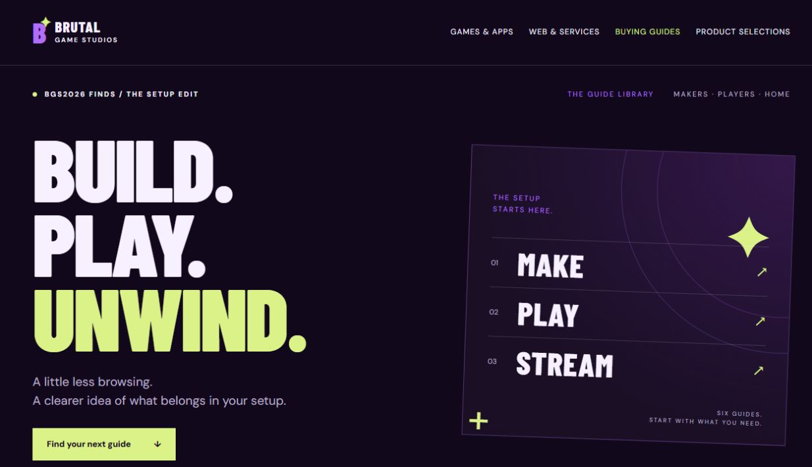
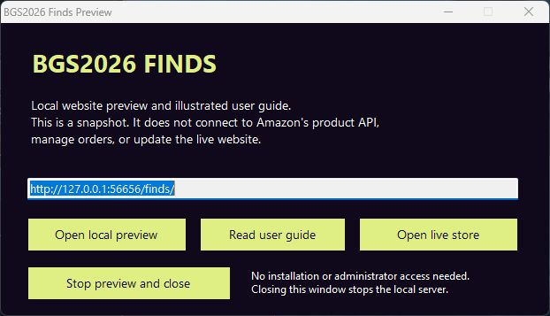
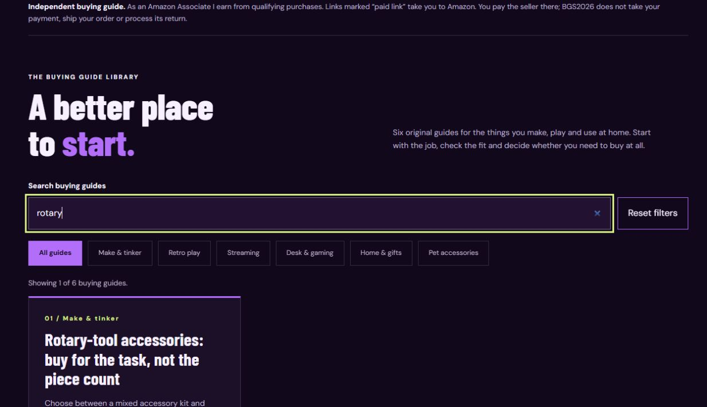
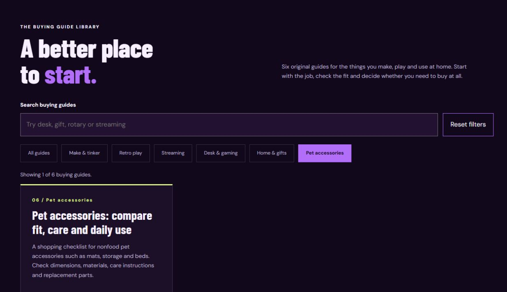
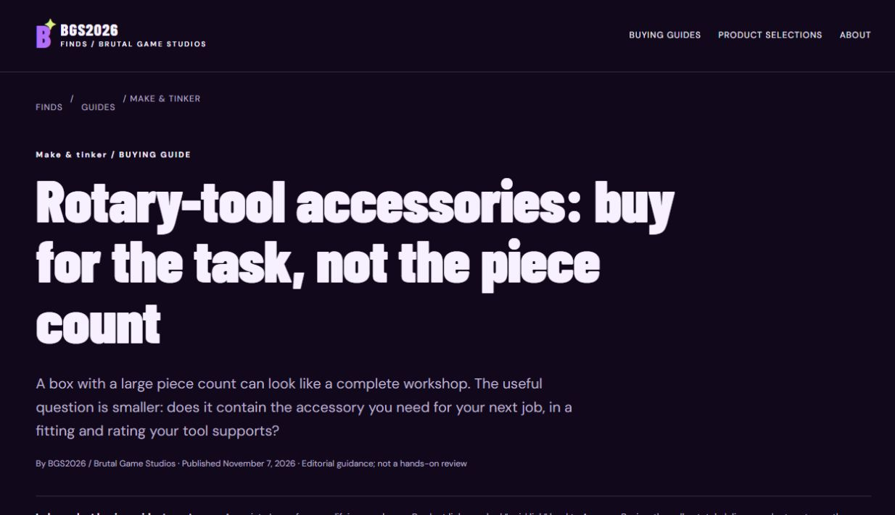
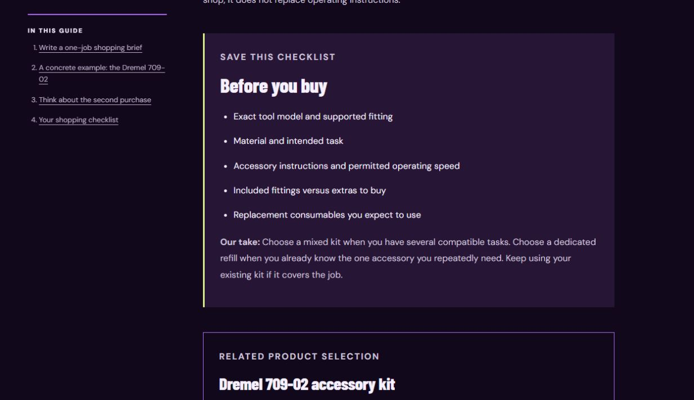
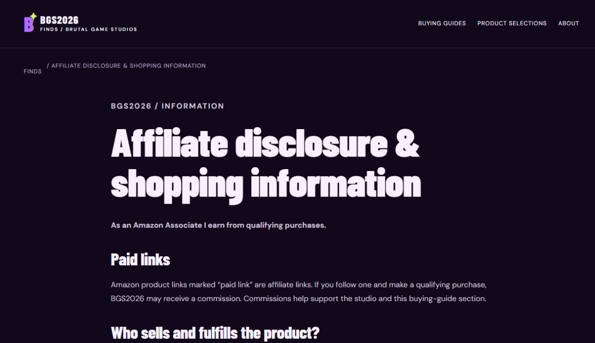
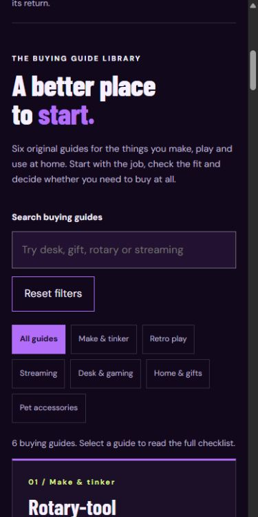

# BGS2026 Finds illustrated user guide

Use this guide to browse the store, maintain its buying guides, prepare lawful product entries and start free promotion. It also explains the Windows preview program and what you still need from Amazon before adding a large photographed catalog.

The current business model is referral commission: someone reads a BGS2026 guide, follows a marked Amazon link and buys from the seller shown there. BGS2026 may earn a commission on a qualifying purchase. You do not buy stock, pack these products or run their checkout on this website.

Prepared November 7, 2026. The screenshots show the actual BGS2026 website. Account interfaces and service requirements can change; use the linked official documentation when setting up external accounts.

## Contents

1. [Know what is ready](#know-what-is-ready)
2. [Gather your prerequisites](#gather-your-prerequisites)
3. [Open the website or Windows program](#open-the-website-or-windows-program)
4. [Search and read buying guides](#search-and-read-buying-guides)
5. [Use product links and handle order questions](#use-product-links-and-handle-order-questions)
6. [Check the phone experience](#check-the-phone-experience)
7. [Set up free search discovery](#set-up-free-search-discovery)
8. [Start free promotion](#start-free-promotion)
9. [Review results](#review-results)
10. [Maintain content and product records](#maintain-content-and-product-records)
11. [Publish an update](#publish-an-update)
12. [Troubleshoot common problems](#troubleshoot-common-problems)
13. [Run the operating checklist](#run-the-operating-checklist)

## Know what is ready

The live site is [BGS2026 Finds](https://brutal-game-studios-neon.brutalmotorworks.chatgpt.site/finds/). It includes six guides: maker accessories, retro gifts, streaming devices, desk setups, household gifts and nonfood pet accessories. It also includes three named product selections and the information pages linked in the footer.



**Picture 1.** Start at the live Finds home page. The buying guides and product selections are separate sections.

The following items remain separate tasks:

| Item | Current position | What you need to do |
| --- | --- | --- |
| Amazon support inquiry | Confirmed sent | Read Amazon's actual response when it arrives |
| Final Associates approval | Not confirmed | Follow the account's requirements and support guidance |
| Authorized product-photo API | Not available in the last account check | Obtain access before connecting an image feed |
| Imported photo catalog | Empty and hidden | Add only verified records with authorized, fresh images |
| Search Console | Not configured during this work | Verify ownership and submit the sitemap |
| Promotional posts | Drafts prepared; not published | Choose your channels and publish appropriate drafts |
| Tax and payout setup | Completion not verified | Check those sections privately in Amazon |

Amazon normally reviews an application after three qualifying sales in 180 days; personal orders do not count. This is separate from API eligibility. Keep your declared sites accurate and read [Amazon's application-review explanation](https://affiliate-program.amazon.com/help/node/topic/G8TW5AE9XL2VX9VM). Do not ask people to make artificial purchases to force approval.

## Gather your prerequisites

For normal operation, you need an internet connection, a current web browser, access to your business email and access to the Amazon Associates account. You also need the authority to manage the website and whatever social accounts you decide to use.

For search discovery, use a Google account you control and Search Console. For publishing the guide or source, use a GitHub account with write permission to the existing repository. Keep two-step verification and recovery information under your control.

For product entries, gather the exact manufacturer model, pack size or variant, verified Amazon destination, an original useful description and documented permission to display the photograph. An image found through a search engine is not automatically licensed for this purpose.

For the Windows EXE, use Windows with .NET Framework 4.8 or 4.8.1 and a default browser. For source builds, use Node.js 22.13 or newer; building the Windows EXE also needs PowerShell and a .NET Framework C# compiler. Links and alternatives are in [Dependencies and prerequisites](DEPENDENCIES.md).

You do not need a paid ad account, paid SEO tool, stock purchase or paid design subscription to follow this guide. External services can have account terms or limits, so check the option you choose before accepting anything that charges money.

## Open the website or Windows program

### Use the live site

Open the live website in your browser. Bookmark the Finds page and the business email account. The website does not need the Windows EXE, Node.js or Git installed on the visitor's computer.

### Download the Windows preview

1. Open this repository's `bgs2026/downloads/` folder.
2. Select `BGS2026-Finds-Preview.exe`, then use GitHub's **Download raw file** control. Saving GitHub's surrounding HTML page is not downloading the program.
3. Compare its SHA-256 with `SHA256SUMS.txt`. In PowerShell, use the command below with the actual path to your download.
4. Run the program if you choose to trust this first-party unsigned build. A code-signing certificate is not included. If your security settings prevent it, use the live website or inspect and build the source instead; this guide does not require disabling protections.

```powershell
Get-FileHash -Algorithm SHA256 -LiteralPath '.\BGS2026-Finds-Preview.exe'
```

The program opens a small control window and the local copy in your default browser. The local address starts with `http://127.0.0.1:` and uses an automatically chosen port.



**Picture 2.** The Windows control window distinguishes the local snapshot, its guide and the live store. The port shown on your computer can differ.

- **Open local preview** opens the embedded website snapshot.
- **Read user guide** opens this illustrated guide from the embedded copy.
- **Open live store** opens the current public website and requires internet access.
- **Stop preview and close** closes the application and its local server.

The program does not install itself, request administrator rights, change a firewall setting or keep running in the system tray. It serves an embedded read-only copy over the computer's loopback interface. It cannot update the public website, import Amazon account information or verify commissions.

The local HTML, scripts, guide and screenshots are embedded. External fonts and external links need internet access; without Google Fonts, the page uses fallback fonts. Actual shopping belongs on the live site and Amazon. Closing the control window makes the local browser address stop responding, which is expected.

## Search and read buying guides

1. On Finds home, choose **Find your next guide** or **Buying guides** in the navigation.
2. Type a short phrase in **Search buying guides**. Try `rotary`, `desk` or `gift`.
3. Read the result count below the categories.
4. Select a guide title to open the full article.



**Picture 3.** `rotary` narrows the six-guide library to its maker article. Search checks the visible guide-card text; it is not a full-site or Amazon search.

The category buttons narrow the same guide list. Search and category apply together, so choosing **Pet accessories** while leaving `rotary` in the box can produce no results. Use **Reset filters** to clear both and return to all six guides.



**Picture 4.** The active category is highlighted. A zero-result message means the current filter combination matches nothing; it does not mean products are out of stock.

Inside an article, use **In this guide** to jump to a section or **Your shopping checklist**. Read the limitations as well as the suggested uses. These articles are editorial buying guidance, not claims of personal testing.



**Picture 5.** Each guide has its own URL and contents links. Share the relevant article URL when it answers someone's question.



**Picture 6.** The checklist turns an article into a practical buying decision. A reader can decide to keep their existing equipment.

## Use product links and handle order questions

The three product selections describe the Dremel 709-02 kit, My Arcade Atari Nano Player Pro and Fire TV Stick 4K Select. Their links contain BGS2026's Associates identifier. Do not replace it accidentally when editing the site.

When a reader selects **View on Amazon**, Amazon opens in a new tab. The reader must check the exact model, variant, seller, total, availability, delivery and return terms there. BGS2026 does not publish a current price or guaranteed delivery date on these cards.



**Picture 7.** The disclosure describes who earns a referral commission and who sells and fulfills an order.

For an order problem, direct the customer to **Your Orders** on Amazon and that order's support instructions. Do not collect their card details, passwords or order documents. For a factual guide correction, use the Contact link and business email shown on the page.

The local preview's product links also lead outside the app. Do not buy through your own links to test commission attribution. Checking a link destination is different from creating a qualifying purchase.

## Check the phone experience

Open the public page on your actual phone and perform the same short journey: find a guide, search, reset, open the article, use the checklist and return to the library. Confirm text is readable without sideways scrolling and the links are easy to tap.



**Picture 8.** At phone width, search, category buttons and articles stack vertically. This screenshot is a browser-sized phone preview, not proof of testing on every phone model.

After a content change, check both a narrow phone view and a desktop view. Long model numbers, URLs and titles can reveal overflow that short placeholder text would miss. Browser resizing or developer responsive tools are useful; a physical phone test adds information about touch behavior and the actual browser.

## Set up free search discovery

The live site's sitemap is already at [sitemap.xml](https://brutal-game-studios-neon.brutalmotorworks.chatgpt.site/sitemap.xml), with the guide URLs included. Search Console setup still needs the account owner's participation.

1. Open [Google Search Console](https://search.google.com/search-console/) and sign in yourself.
2. Add a **URL-prefix** property for the full live site URL shown below.
3. Follow an available verification method. HTML tag or file verification needs a corresponding site deployment. Do not choose DNS verification for a parent domain you do not control.
4. Once ownership is verified, submit the site's sitemap from **Sitemaps**.
5. Use **URL Inspection** for an important guide and request indexing if appropriate. Review the indexing result later.

```text
https://brutal-game-studios-neon.brutalmotorworks.chatgpt.site/
```

Adding a property enables reporting; it does not itself improve rankings. Keep any required verification tag/file in place. See [Google's property setup instructions](https://support.google.com/webmasters/answer/34592?hl=en), [sitemap instructions](https://developers.google.com/search/docs/crawling-indexing/sitemaps/build-sitemap) and [recrawl guidance](https://developers.google.com/search/docs/crawling-indexing/ask-google-to-recrawl).

Indexing can take days to weeks and is not guaranteed. Repeatedly submitting the same URL is not a shortcut. Promote the current live URL, not a local `127.0.0.1` preview or a GitHub mirror.

## Start free promotion

Begin with one audience and one useful decision. Maker accessories and retro-gaming gifts fit the studio's current subjects. Use the ready [promotion drafts](operations/promotion-drafts.txt) and the expanded [free promotion plan](FREE_PROMOTION.md).

For the first week, use this manageable experiment:

| Day | Action | Output |
| --- | --- | --- |
| 1 | Set profile link and begin Search Console verification | One clear route to the live Finds page |
| 2 | Make a short maker checklist video | One original video with a guide destination |
| 3 | Answer relevant community questions | Useful replies; a link only where appropriate and permitted |
| 4 | Publish a retro-gift checklist video | A second original topic to compare |
| 5 | Share one guide where promotion is allowed | One disclosed, context-appropriate guide post |
| 6 | Make a third video based on a real reader question | A specific explanation, not a copied product ad |
| 7 | Review available views, clicks and Amazon reports | Decide which topic to improve next |

These are activity targets, not visitor or sales promises. Use original footage, diagrams, checklist graphics or screen recordings of our own pages. Do not copy Amazon product photographs into videos or social posts without an applicable permission.

On YouTube Shorts, direct viewers to the channel's profile link. URLs in Shorts descriptions and comments are not clickable; YouTube's [link guide](https://support.google.com/youtube/answer/13748639?hl=en) explains the distinction. For community posts, read the actual community rules first. [Reddit's spam guidance](https://support.reddithelp.com/hc/en-us/articles/360043504051-Spam) is relevant to repeated business-link promotion.

Use clear disclosure near a promotion, for example: “This is our buying guide and it contains paid Amazon links. As an Amazon Associate I earn from qualifying purchases.” Keep the website's own disclosure visible as well. Use truthful descriptions instead of claims such as “best seller,” “personally tested” or “lowest price” unless you can substantiate them.

## Review results

Start with the reports you already have access to. A video's views are not the same as site visits, and site visits are not Amazon purchases. The site has no added visitor analytics dashboard, so do not treat a blank dashboard as proof nobody visited.

Search Console can show Google search impressions and clicks after setup and data collection. Social platforms show their own available view/link metrics. Amazon Associates reports show their own qualifying activity. Record the date range and report type beside each number.

Use the [weekly log template](operations/weekly-log-template.txt). Record what you posted, which guide it led to and any actual questions you received. If many people see a video but few follow the link, improve the connection between the video and guide. If a guide gets interest but few product clicks, check whether it matches the visitor's intent before adding more products.

Commissions are subject to the account's current terms, eligibility and adjustments. Verify tax/payment completion privately in Amazon. Do not put credentials, tax details or bank information into this repository or a public issue. No first-sale date or income amount is guaranteed.

## Maintain content and product records

### Update an existing guide

For an editorial change, edit the matching entry in `src/content/finds-guides.mjs`. Keep the title, description, section paragraphs, checklist and decision consistent. Verify named product facts at the manufacturer source and update the check date when you have actually rechecked them.

For the front page's three product panels, edit `src/storefront/finds.html`. For a shared article layout or information page, edit `src/lib/finds-pages.mjs`. For appearance, edit `src/public/finds.css` and `src/public/finds-guides.css`.

Do not describe untested equipment as personally tested. If a model, feature or included accessory cannot be verified, remove or narrow that claim. A corrected guide is more useful than a larger set of uncertain statements.

### Prepare a new product

Use [the product queue](operations/product-queue.txt). Before publishing a photo card, establish:

- Exact manufacturer model, ASIN and selected size/color/pack count.
- A verified destination with the correct affiliate identifier.
- A concise original description, appropriate category and useful limitation.
- A photograph you are authorized to display, its source and permission record.
- Freshness timestamps for an Amazon API image, when authorized access exists.
- Appropriate alt text and a working image/link in the phone layout.

The catalog validator lives in `src/lib/finds-catalog.mjs`, and the current source catalog is `src/catalog/finds.json`. It is intentionally empty. A future developer must implement authorized retrieval and refresh for a live API connection. Manually setting a permission flag does not create a license or establish account eligibility.

Amazon's API access has separate requirements from ordinary application review. Check [Creators API registration](https://affiliate-program.amazon.com/creatorsapi/docs/en-us/onboarding/register-for-creators-api) and the account's current message. Image use and refresh must follow [Amazon's applicable policies](https://affiliate-program.amazon.com/help/operating/policies). The existing validator rejects missing or expired image records. The portable static snapshot cannot run a background refresh after it is built.

## Publish an update

There are three distinct outputs:

| Output | What updates it |
| --- | --- |
| The live ChatGPT-hosted Finds website | Its existing Sites publishing workflow |
| The source and guide on GitHub | A reviewed commit pushed to this repository |
| The Windows preview EXE | A new local build and upload of the resulting binary/checksum |

A GitHub commit alone does not redeploy the existing ChatGPT-hosted site. Rebuilding the EXE alone does not change a file already downloaded to another computer. See [the developer guide](DEVELOPMENT.md) for commands, source layout and the release sequence.

For a content release, check links, mobile layout, disclosure and catalog validation first. Update the guide or dependency notes if behavior changed. Rebuild the site and EXE from the same source state, then record checksums. Keep existing privacy-policy files in the parent repository intact.

## Troubleshoot common problems

| Problem | Check and action |
| --- | --- |
| Search shows zero guides | Clear the query and choose Reset filters; search and category combine |
| Photo catalog is missing | It is intentionally hidden while empty; inspect permissions and freshness before adding records |
| Local page stops loading | Reopen the EXE or restart the Node preview; closing the server stops that address |
| Windows EXE does not start | Confirm .NET Framework and Windows prerequisites; use the live site or source alternative if blocked |
| Fonts look different offline | Google Fonts needs a network connection; fallback fonts are expected |
| A product price differs | The site does not quote a live offer; the current Amazon offer controls |
| A buyer requests a refund | Refer them to their Amazon order; BGS2026 cannot refund the seller's order |
| No Google search data yet | Verify Search Console setup and indexing; new-site discovery takes time |
| No commission recorded | Check the correct date range and Amazon account reports; views and link clicks do not guarantee a qualifying purchase |
| GitHub changes are absent from the live site | GitHub publication and the existing live-site deployment are separate workflows |

If an issue persists, include the public page URL, browser/device and a short reproduction description. Leave out private account details.

## Run the operating checklist

### Before promotion

- Open the public guide URL on a phone and desktop.
- Check the headline, relevant product destination and disclosure.
- Use original or appropriately licensed media.
- Read the destination community/platform rules.
- Select one guide and one clear call to action.

### Each week

- Review actual questions and available reports.
- Check the three named product destinations and any factual changes.
- Review Amazon support/account messages directly.
- Update the weekly log and improve one useful guide.
- Verify any public content changes do not expose private information.

### Before expanding the catalog

- Confirm Amazon authorization or another valid image license.
- Verify exact product identities and link destinations.
- Implement and test the required data refresh.
- Test a small real batch before scaling.
- Keep unsupported records unpublished.

### Where to go next

[Developer instructions](DEVELOPMENT.md) · [Dependencies and official software links](DEPENDENCIES.md) · [Free promotion details](FREE_PROMOTION.md) · [Third-party notices](../THIRD_PARTY_NOTICES.md)
